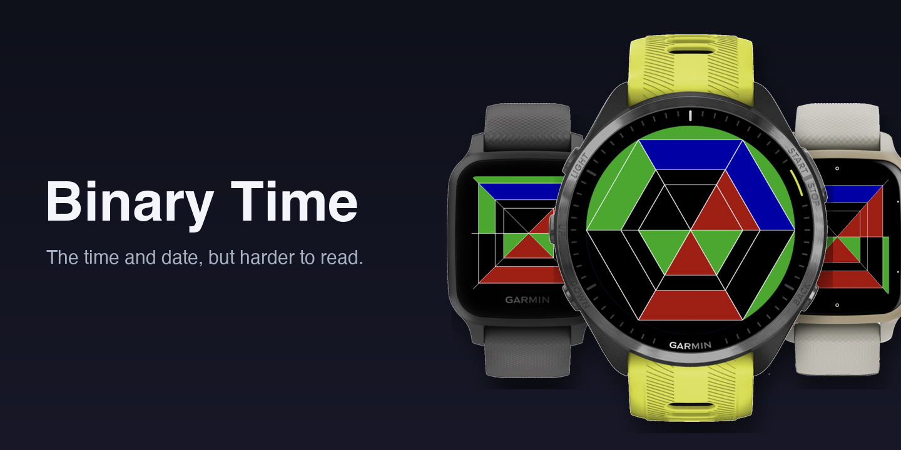

# Binary Time

A Garmin Connect IQ watch face that shows the time and date in binary. Each value is drawn as a shape with six triangular segments, one per bit, so you read the time by which segments are lit.

## How to read it

The face has three nested shapes, plus a seconds ring behind them. On a round screen the shapes are hexagons. On a square or rectangular screen they stretch to fit the screen.

| Shape | Shows |
|---|---|
| Outer | Minutes (value 1) and hour (value 2), overlaid |
| Middle | Day of week: Monday to Saturday light one segment, Sunday lights none |
| Inner | Day of month (value 1) and month (value 2), overlaid |
| Seconds ring | Seconds in binary, drawn behind the outer shape. Shown only while the watch is awake |

Each shape has six segments, least significant bit first. Bit 0 is the top segment and bits go clockwise.

Where two values overlay in one shape, the segment colour is the sum of the bits set:

| Sum | Colour setting | Default |
|---|---|---|
| 0 | none (black) | black |
| 1 | First Color | green |
| 2 | Second Color | red |
| 3 | Combo Color | blue |

In the outer shape a first-colour segment is a minute bit, a second-colour segment is an hour bit and a combo segment is both. The inner shape works the same way with day and month.

The outline of the shapes shows AM or PM (black for AM and white for PM by default). In 12-hour mode midnight shows as 12.

## Settings

Set these in Garmin Connect (or Garmin Express). Each takes one of 14 colours.

- First Color
- Second Color
- Combo Color
- Seconds Color
- AM Color
- PM Color

## Supported devices

Fenix 5/5S/5X (and Plus), Fenix 6 family, Fenix 7 family, Fenix Chronos, Forerunner 55/955/965, and Vivoactive, Vivoactive HR, 3 (all variants) and 4/4S. The full list is in `manifest.xml`. Minimum Connect IQ API level is 1.4.0.

## Build and run

You need the [Connect IQ SDK](https://developer.garmin.com/connect-iq/sdk/) and the Monkey C extension for VS Code.

1. Open the folder in VS Code.
2. Run the "Run App" launch configuration (`.vscode/launch.json`). It targets `fr55` by default, so change the device there to try another one.
3. Use "Monkey C: Build for Device" to produce a `.prg` for sideloading.

## Project layout

- `source/binarytimeView.mc`: drawing and time logic.
- `source/binarytimeApp.mc`: app entry point; redraws when settings change.
- `resources/settings/`: setting definitions (`settings.xml`) and default colours (`properties.xml`).
- `resources/strings/strings.xml`: setting and colour names.
- `manifest.xml`: app id, target devices and API level.
- `pictures/`: screenshots and store artwork.
